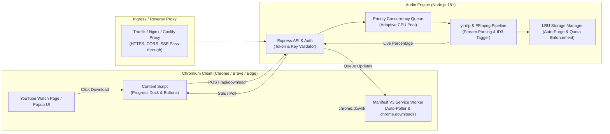

# 🎧 YouTube to MP3 Pro — High-Performance Audio Engine & Chrome Extension

[](https://nodejs.org/)
[](https://developer.chrome.com/docs/extensions/mv3/)
[](https://ffmpeg.org/)
[](https://github.com/yt-dlp/yt-dlp)
[]()
[]()

A production-grade, self-hosted YouTube to MP3 conversion ecosystem. Combines an advanced Chromium browser extension (Manifest V3) with an auto-adapting Node.js backend running `yt-dlp` and `FFmpeg`. Engineered for high concurrency, multi-OS compatibility (Windows & Ubuntu Linux/Coolify), automatic client-side device downloads, real-time conversion progress, and temporary manual download links.

---

## 📑 Table of Contents

- [✨ Key Features](#-key-features)
- [🏗️ System Architecture](#️-system-architecture)
- [📁 Project Layout](#-project-layout)
- [🚀 Quickstart Guide](#-quickstart-guide)
  - [Prerequisites](#prerequisites)
  - [1. Server Setup (Windows)](#1-server-setup-windows)
  - [2. Server Setup (Ubuntu / Debian VPS)](#2-server-setup-ubuntu--debian-vps)
  - [3. Server Setup (Docker & Coolify)](#3-server-setup-docker--coolify)
  - [4. Chrome Extension Installation](#4-chrome-extension-installation)
- [🎮 User Guide & Features](#-user-guide--features)
  - [Inline YouTube Watch Page Integration](#inline-youtube-watch-page-integration)
  - [Floating Progress Dock & Manual Links](#floating-progress-dock--manual-links)
  - [Multi-Download Popup Manager](#multi-download-popup-manager)
  - [Automatic Client-Side File Saving](#automatic-client-side-file-saving)
- [🛡️ High-Traffic & Load Protection](#️-high-traffic--load-protection)
- [⚙️ Configuration & Environment Variables](#️-configuration--environment-variables)
- [🔌 REST API Reference](#-rest-api-reference)
- [🔧 Troubleshooting & FAQ](#-troubleshooting--faq)
- [📜 License](#-license)

---

## ✨ Key Features

### 🖥️ Extension (Manifest V3)
- **1-Click YouTube Integration:** Seamlessly injects a purple gradient `🎧 Download MP3` action button on YouTube watch pages, plus quick-download overlays on video thumbnail cards.
- **Floating Progress Dock:** Displays real-time conversion percentage on YouTube tabs with shimmer animations, current stage indicators (`Downloading`, `FFmpeg Transcoding`, `Embedding Tags & Art`), direct **⬇️ Download File** manual trigger, and **📋 Copy Temp Link** button.
- **Autonomous Client Saving:** Manifest V3 background service worker automatically polls the queue and triggers native `chrome.downloads.download()`, saving files straight to your system's `Downloads/YouTube_MP3s/` folder even if the popup is closed.
- **Glassmorphic Popup Manager:** Full queue dashboard with batch URL submission (paste 20+ links), audio bitrate selection (`320 kbps HQ`, `256 kbps`, `192 kbps`, `128 kbps`), concurrency controls, real-time SSE progress, and item retry/removal actions.
- **Ephemeral Download Tokens:** Generates secure, 30-minute authenticated download links per conversion item that work natively in the browser without leaking your master server API key.

### ⚙️ Server (Node.js + yt-dlp + FFmpeg)
- **Universal Multi-OS Adaptation:** Auto-detects operating system (Windows vs Linux/Ubuntu/macOS) and dynamically resolves binaries (`yt-dlp.exe` / `ffmpeg.exe` on Windows; `/usr/local/bin/yt-dlp`, `ffmpeg-static`, or system PATH on Linux).
- **Adaptive Concurrency Pool:** Automatically computes safe parallel download workers based on physical CPU cores (`Math.min(3, Math.max(1, Math.floor(cpus / 2)))`) to prevent CPU starvation.
- **Memory & Queue Protection:** Enforces strict queue limits (`MAX_QUEUE_CAPACITY=100`), prunes completed items from memory, and terminates completed downloads safely.
- **Proactive Disk Quota (LRU Cache):** Automatically monitors the temporary conversion storage (`MAX_TEMP_STORAGE_MB=2048`). When storage exceeds 2 GB, the oldest completed audio files are evicted using an LRU (Least Recently Used) algorithm.
- **Process Timeout & Zombie Killer:** Kills hung yt-dlp processes after a configurable timeout (default: 8 minutes) using cross-platform process tree termination (`taskkill /t /f` on Windows, `SIGKILL` on Linux).
- **High-Load DoS Guard:** Dual-tier rate limiting (general API limit + strict 30 requests/min download submission limiter per IP).
- **Metadata & Album Art:** Embeds full ID3v2 tags (Song Title, Channel/Artist name, Year, and high-res cover art cropped and embedded via FFmpeg/node-id3).

---

## 🏗️ System Architecture



---

## 📁 Project Layout

```
yttomp3/
├── extension/                  # Chromium Extension (Manifest V3)
│   ├── manifest.json           # Extension permissions, scripts, icons
│   ├── background.js           # MV3 background worker, auto-poller, native saver
│   ├── content.js              # DOM injector: watch button, dock & card buttons
│   ├── content.css             # Glassmorphism styling, dock, progress bars
│   ├── popup.html              # Extension dashboard UI
│   ├── popup.js                # Queue manager, SSE client, manual links
│   ├── popup.css               # Popup dark-mode styles
│   ├── config.js               # Server URL & default settings
│   └── icons/                  # 16px, 48px, 128px extension icons
│
├── server/                     # Backend Audio Processing Engine
│   ├── bin/                    # Pre-bundled Windows executables (yt-dlp, ffmpeg)
│   ├── data/                   # Download history & metadata cache
│   ├── public/                 # Standalone web UI interface
│   ├── server.js               # Express application, routes, SSE bus & rate limiters
│   ├── queue.js                # Concurrency controller & LRU storage cleaner
│   ├── yt-dlp-helper.js        # yt-dlp binary resolver, execution & progress parser
│   ├── ffmpeg-converter.js     # FFmpeg pipeline & ID3v2 tag injector
│   ├── history.js              # Persistence manager for download history
│   ├── Dockerfile              # Multi-stage production container for Linux/Coolify
│   ├── ecosystem.config.js     # PM2 production configuration
│   ├── nginx.conf              # Production Nginx reverse proxy configuration
│   ├── package.json            # Node.js dependencies & scripts
│   ├── .env                    # Local environment variables
│   └── .env.example            # Environment template with safety limits
│
├── README.md                   # Project documentation & quickstart
└── Projectdoc.md               # Technical architecture & design specification
```

---

## 🚀 Quickstart Guide

### Prerequisites
- **Node.js:** v18.0.0 or higher
- **FFmpeg:** Installed on system PATH or auto-loaded via `ffmpeg-static`
- **yt-dlp:** Installed or placed in `server/bin/` (bundled on Windows, auto-installed in Docker)

---

### 1. Server Setup (Windows)

The repository comes pre-bundled with Windows binaries in `server/bin/`.

```powershell
# 1. Navigate to the server folder
cd f:\yttomp3\server

# 2. Install dependencies
npm install

# 3. Create your .env file
copy .env.example .env

# 4. Start the server
npm start
```
*Server will listen on `http://localhost:3500`.*

---

### 2. Server Setup (Ubuntu / Debian VPS)

For a raw Ubuntu server (bare metal or cloud VPS):

```bash
# 1. Update packages and install FFmpeg and Python
sudo apt update && sudo apt install -y ffmpeg python3 curl

# 2. Install latest yt-dlp globally
sudo curl -L https://github.com/yt-dlp/yt-dlp/releases/latest/download/yt-dlp -o /usr/local/bin/yt-dlp
sudo chmod a+rx /usr/local/bin/yt-dlp

# 3. Verify binaries
yt-dlp --version
ffmpeg -version

# 4. Clone repo and install Node dependencies
git clone <repo-url> /var/www/yttomp3
cd /var/www/yttomp3/server
npm install --production

# 5. Configure environment
cp .env.example .env
nano .env

# 6. Start with PM2
npm install -g pm2
npm run pm2:start

# 7. Enable auto-start on boot
pm2 startup
pm2 save
```

---

### 3. Server Setup (Docker & Coolify)

The included `server/Dockerfile` is pre-configured with Linux `ffmpeg`, `yt-dlp`, and non-root runtime safety.

#### Running with Docker:
```bash
cd server
docker build -t yttomp3-server .
docker run -d \
  -p 3500:3500 \
  -e API_KEY=your_secure_random_api_key \
  -e PRODUCTION_URL=https://ytmp3.yourdomain.com \
  --name yttomp3 \
  yttomp3-server
```

#### Deploying on Coolify:
1. In your Coolify dashboard, create a new **Application** $\rightarrow$ **From Git Repository** or **Public Repository**.
2. Set the **Build Pack** to `Dockerfile` and point the path to `/server/Dockerfile`.
3. Set the **Exposed Port** to `3500`.
4. In **Environment Variables**, add:
   ```env
   NODE_ENV=production
   PORT=3500
   HOST=0.0.0.0
   TEMP_DIR=/tmp/ytmp3_temp
   PRODUCTION_URL=https://ytmp3.yourdomain.com
   API_KEY=YOUR_SECURE_RANDOM_KEY
   MAX_CONCURRENCY=2
   MAX_TEMP_STORAGE_MB=2048
   DOWNLOAD_TIMEOUT_MS=480000
   RATE_LIMIT_SUBMISSIONS_PER_MIN=30
   ```
5. Deploy! Coolify automatically provisions SSL certificates and handles reverse proxying.

---

### 4. Chrome Extension Installation

1. Open **Google Chrome** (or Brave, Edge, Opera, Vivaldi).
2. Navigate to `chrome://extensions/` in your address bar.
3. Turn on **Developer mode** (toggle in the top-right corner).
4. Click **Load unpacked** (top-left).
5. Select the `extension` folder (`f:\yttomp3\extension`).
6. Click the extension puzzle icon $\rightarrow$ Pin **🎧 YouTube to MP3**.
7. Open the extension popup $\rightarrow$ Click **⚙️ Settings** $\rightarrow$ Verify:
   - **Server URL:** `http://localhost:3500` (or your remote `https://ytmp3.yourdomain.com`)
   - **API Key:** Matches `API_KEY` in your server `.env`
   - Click **Save Settings**.

---

## 🎮 User Guide & Features

### Inline YouTube Watch Page Integration
When viewing any YouTube video (`youtube.com/watch?v=...`), a purple gradient **🎧 Download MP3** button appears directly next to the Like / Share action bar. Clicking this button immediately submits the video to your conversion queue.

### Floating Progress Dock & Manual Links
Once queued, a floating glassmorphic Progress Dock automatically slides in at the bottom-right of your YouTube screen:
- **Real-Time Percentage:** Displays exact live progress (e.g. `📥 Downloading 45%` $\rightarrow$ `⚙️ Converting 82%` $\rightarrow$ `🎨 Tags & Art 95%` $\rightarrow$ `✅ Saved 100%`).
- **⬇️ Download File:** Direct manual download button that immediately triggers client-side saving.
- **📋 Copy Temp Link:** Copies a 30-minute direct temporary download URL to your clipboard for sharing or downloading with tools like `curl` or `wget`.

### Multi-Download Popup Manager
Click the toolbar icon to manage conversions:
- **Batch Processing:** Paste 1 to 50 YouTube links into the text box (one per line) and convert them all in parallel.
- **Bitrate Selector:** Choose between `320k HQ` (CBR high quality), `256k`, `192k`, or `128k`.
- **Parallel Slider:** Dynamically throttle parallel downloads from 1 to 5 simultaneous slots.
- **Actions:** Retry failed items, cancel pending items, or clear completed items with one click.

### Automatic Client-Side File Saving
Under Manifest V3, background service workers manage downloads:
1. When conversion finishes on the server, the background worker receives notification via its active polling loop.
2. The background worker calls `chrome.downloads.download()`, prompting Chrome's native download manager.
3. The MP3 file with sanitized song title and embedded ID3 tags is saved directly to your computer's `Downloads/YouTube_MP3s/` folder.
4. **No active popup required:** You can close the popup or navigate away; downloads will finish and save automatically in the background.

---

## 🛡️ High-Traffic & Load Protection

To operate reliably on small VPS instances (1 vCPU, 1–2 GB RAM) without crashing or exhausting resources, the server includes several protective layers:

| Layer | Mechanism | Protection |
|---|---|---|
| **Adaptive Concurrency** | Allocates $\max(1, \lfloor \text{CPUs}/2 \rfloor)$ worker threads | Prevents CPU starvation and 100% thread locking |
| **Queue Saturation Guard** | Rejects requests with HTTP 429 when queue reaches 100 items | Prevents unbounded memory growth during spikes |
| **LRU Disk Storage Quota** | Enforces 2048 MB limit; auto-purges oldest completed MP3s | Prevents host disk exhaustion |
| **Zombie Process Killer** | Kills processes after 8 minutes via cross-platform tree kill | Prevents zombie `yt-dlp` or `ffmpeg` locks |
| **Submission Rate Limiter** | 30 requests/minute per IP address | Blocks automated spam and malicious flooding |
| **Download Size Guard** | `--max-filesize 350M` and `--no-live-from-start` | Rejects 10-hour livestreams and massive files |
| **Socket Timeout** | `--socket-timeout 25` and `--retries 3` | Drops stalled network connections immediately |
| **Secure Token Auth** | 16-byte random hex tokens valid for 30 minutes | Protects download endpoints without exposing API keys |

---

## ⚙️ Configuration & Environment Variables

Copy `server/.env.example` to `server/.env` and customize as needed:

| Variable | Default | Description |
|---|---|---|
| `PORT` | `3500` | Port Express listens on |
| `HOST` | `0.0.0.0` | Bind address (`0.0.0.0` for Docker/remote, `127.0.0.1` for local-only) |
| `NODE_ENV` | `production` | Environment mode (`production` or `development`) |
| `TEMP_DIR` | `/tmp/ytmp3_temp` | Temporary conversion directory (Windows: `Downloads/YouTube_MP3s`) |
| `PRODUCTION_URL` | `https://ytmp3.yourdomain.com` | Public base URL used for CORS validation and manual temp links |
| `API_KEY` | *(Required in prod)* | Secret master API key checked against `X-API-Key` headers |
| `MAX_CONCURRENCY` | `2` *(or auto)* | Max simultaneous conversions (omitting enables CPU auto-detect) |
| `MAX_QUEUE_CAPACITY` | `100` | Max in-memory queue items before rejecting with 429 |
| `MAX_TEMP_STORAGE_MB`| `2048` | Maximum temp folder disk quota in MB before LRU auto-purge triggers |
| `DOWNLOAD_TIMEOUT_MS`| `480000` | Process timeout in ms (8 minutes) before forced tree termination |
| `MAX_FILESIZE` | `350M` | Maximum allowed video file size to download |
| `RATE_LIMIT_WINDOW_MS`| `900000` | General rate limit window in milliseconds (15 minutes) |
| `RATE_LIMIT_MAX_REQUESTS`| `300` | Maximum API calls per IP in general rate limit window |
| `RATE_LIMIT_SUBMISSIONS_PER_MIN` | `30` | Maximum `/api/download` submissions allowed per IP per minute |
| `YTDLP_PATH` | *(Auto-detected)* | Path override for `yt-dlp` binary |
| `FFMPEG_PATH` | *(Auto-detected)* | Path override for `ffmpeg` binary |
| `LOG_LEVEL` | `info` | Logging verbosity (`info`, `debug`, `warn`, `error`) |

---

## 🔌 REST API Reference

All requests modifying or accessing the queue require the `X-API-Key: <YOUR_API_KEY>` header, unless using temporary download tokens.

### 1. Health & Server Metrics
```http
GET /health
```
**Response (200 OK):**
```json
{
  "status": "healthy",
  "uptime": 1420.5,
  "memory": { "usedMb": 58, "totalMb": 1024, "percent": 5.66 },
  "storage": { "usedMb": 184.2, "maxQuotaMb": 2048, "percentUsed": 9.0 },
  "queue": { "active": 1, "queued": 0, "completed": 4, "failed": 0 }
}
```

### 2. Submit Video to Queue
```http
POST /api/download
Content-Type: application/json
X-API-Key: YOUR_API_KEY

{
  "url": "https://www.youtube.com/watch?v=dQw4w9WgXcQ",
  "quality": "320k"
}
```
**Response (200 OK):**
```json
{
  "success": true,
  "id": "1728723910000-abc1234",
  "message": "Added to queue",
  "position": 1
}
```

### 3. Get Full Queue Snapshot
```http
GET /api/queue
X-API-Key: YOUR_API_KEY
```
**Response (200 OK):**
```json
{
  "items": [
    {
      "id": "1728723910000-abc1234",
      "url": "https://www.youtube.com/watch?v=dQw4w9WgXcQ",
      "title": "Rick Astley - Never Gonna Give You Up",
      "status": "completed",
      "progress": 100,
      "stage": "completed",
      "quality": "320k",
      "filename": "Rick Astley - Never Gonna Give You Up.mp3",
      "fileSize": 8412940,
      "downloadUrl": "http://localhost:3500/api/download-file/1728723910000-abc1234?token=a1b2c3d4e5f67890",
      "downloadToken": "a1b2c3d4e5f67890"
    }
  ],
  "stats": { "active": 0, "queued": 0, "completed": 1, "failed": 0 }
}
```

### 4. Direct File Download (Token Authenticated)
```http
GET /api/download-file/:id?token=a1b2c3d4e5f67890
```
- **Returns:** Raw MP3 binary stream with `Content-Disposition: attachment; filename="..."`.
- **Authentication:** Validated via item-specific `downloadToken` query param or master `X-API-Key` header.
- **Retention:** Files remain available for 30 minutes or until LRU quota eviction.

### 5. Live Server-Sent Events (SSE) Stream
```http
GET /api/progress
```
Streams real-time JSON events:
```text
event: progress
data: {"id":"1728723910000-abc1234","status":"downloading","progress":45,"stage":"downloading"}

event: complete
data: {"id":"1728723910000-abc1234","status":"completed","progress":100,"filename":"Song.mp3","downloadUrl":"..."}
```

### 6. Queue Management Endpoints
- `DELETE /api/queue/:id` — Cancel an in-flight or queued item.
- `POST /api/queue/:id/retry` — Re-queue a failed conversion.
- `POST /api/queue/clear-completed` — Purge completed records and clean associated disk files.

---

## 🔧 Troubleshooting & FAQ

### Q: Why did downloads finish on the server but not save to my computer?
**A:** In Google Chrome Manifest V3, extension popups close as soon as you click anywhere outside of them. In previous versions, downloads relied on an open popup. In this release, **`background.js` handles downloading directly**:
- The background service worker actively polls the server queue.
- As soon as status is `completed`, `background.js` initiates `chrome.downloads.download()`.
- The file will be saved in your system's `Downloads/YouTube_MP3s/` directory automatically.

### Q: "Failed to extract video: yt-dlp error: Sign in to confirm you're not a bot"
**A:** YouTube periodically throttles or introduces bot checks on certain data center IP ranges.
1. Update yt-dlp to the latest release:
   - **Linux:** `sudo yt-dlp -U` or `sudo curl -L https://github.com/yt-dlp/yt-dlp/releases/latest/download/yt-dlp -o /usr/local/bin/yt-dlp`
   - **Windows:** Replace `server/bin/yt-dlp.exe` with the latest build from [yt-dlp GitHub Releases](https://github.com/yt-dlp/yt-dlp/releases).
2. If hosting on a cloud VPS (Hetzner, OVH, AWS), consider routing requests through a residential proxy or exporting cookies:
   - Export cookies using the "Get cookies.txt locally" extension into `server/cookies.txt`.
   - Add `--cookies cookies.txt` to the `yt-dlp-helper.js` default arguments.

### Q: Why do I see a CORS error when connecting to my Coolify / remote server?
**A:** Check your `PRODUCTION_URL` in `server/.env`. Make sure it includes your exact public protocol and domain without trailing slashes (e.g., `https://ytmp3.yourdomain.com`). The server uses this variable to configure CORS origin headers and validate Chrome extension origins (`chrome-extension://*`).

### Q: How much RAM and CPU does the server need?
**A:** 
- **Minimum:** 1 vCPU, 512 MB RAM (set `MAX_CONCURRENCY=1`).
- **Recommended:** 2 vCPU, 2 GB RAM (set `MAX_CONCURRENCY=2` or `3`).
- Audio transcoding (`FFmpeg -b:a 320k`) is primarily CPU-bound. With adaptive concurrency enabled, the server will never exceed half your available physical CPU cores unless explicitly configured.

---

## 📜 License

This project is licensed under the MIT License. Built for personal, educational, and backup audio archival purposes. Please respect YouTube's Terms of Service and content creators' copyright rights.
